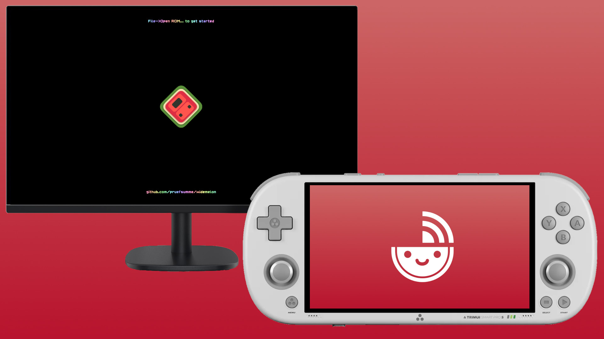

# WideMelon Client

</img>

> "We have the Wii U at home"

 

<a
href="https://github.com/NiCo-dev123/widemelon-linux-client/releases/latest"
style="display:inline-flex; align-items:center; justify-content:center; box-sizing:border-box; padding:14px 32px; min-width:300px ;background-color:#62d55d ;border:4px solid #62d55d; border-radius:100px; color:#000000; text-align:center; text-decoration:none; font-weight:bold;">Download the app</a>

<a
href="github.com/NiCo-dev123/widemelon-linux-client"
style="display:inline-flex; align-items:center; justify-content:center; box-sizing:border-box; padding:14px 32px; min-width:300px; border:4px solid #62d55d; border-radius:100px; color:#62d55d; text-align:center; text-decoration:none; font-weight:bold;">View the repository</a>

## What is WideMelon Client ?

[WideMelon](https://github.com/pruefsumme/widemelon) is an open-source DS emulator based on MelonDS, by [pruefsumme](github.com/pruefsumme).

`WideMelon Client` is an app for the Trimui Smart Pro S that connects to `WideMelon`. It converts your handheld into a controller and bottom screen.

## WideMelon client features

- Play any DS rom on your computer, use the Smart Pro S as a controller.
- Key mapping : Use L2, R2, L3, R3 as additional inputs. Remap any button to your liking.
- Analog mapping : use the analog sticks in games that normally require touch controls.
- Input configs : save your key mapping configuration to access them easily, per game.
